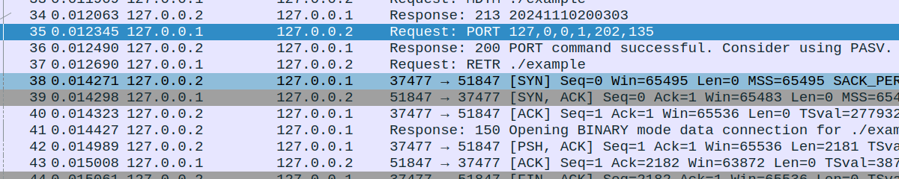

### related connection example  {.smaller}


{}
 

* FTP --- uses separate control + data TCP connections 
<hr class="vspace" />
* PORT command: server creates data connection to specified address 

   * $202 \times 256 + 135 = 51847$
   * problem for firewalls: looks like ‘fresh’ TCP connection


### FTP: server connect to client?  {.smaller}


* PORT command: server creates data connection to specified address
* PASV command: server gets address for client to conect 

   * most FTP clients default to this mode

* why both: in theory, allows direct server-to-server transfers 

   * one client uses PASV on one server, PORT on the other


### other related connections Linux supports  {.smaller}


* usually: separate control and data connections 

   * esp. when data sent with UDP or from different machine
 
<hr class="vspace" />
* direct-client-to-client file transfers in Internet Relay Chat
* SIP, H.323 (video/audio call/conferencing protocols)
* PPTP (VPN protocol)


### nft with conntrack  {.smaller}


```
table inet filter {
    chain forward {
        type filter hook input priority 0

        ct state established accept
        ct state related accept
        ct state invalid drop
        iifname ethInt ct state new accept
        drop
    }
}

```


### connection state timeouts  {.smaller}


* problem: TCP connection with no activity for 30 minutes
* should it stay in table?
* how about after 8 hours? 
<hr class="vspace" />
* Linux conntrack, configurable timeouts: 

   * default: 5 days if in ESTABLISHED TCP state machine state
   * lower for other connection TCP states (e.g. middle of handshake)

* could disagree with end-host timeouts! 

   * mysterious connection dropping


