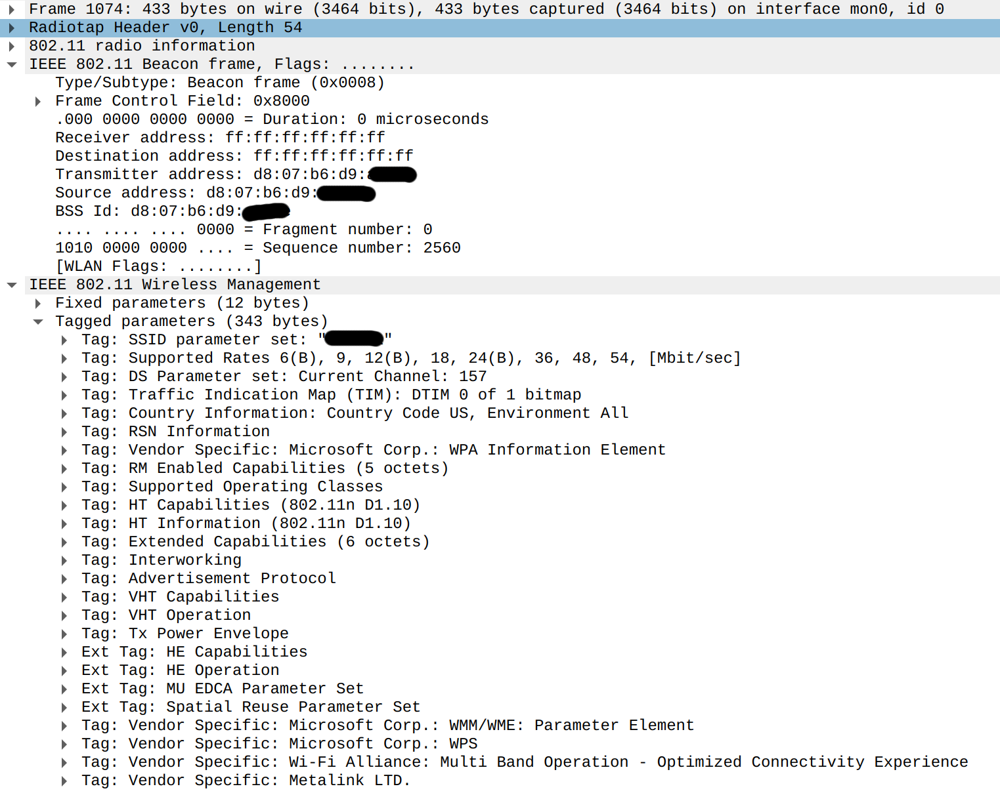
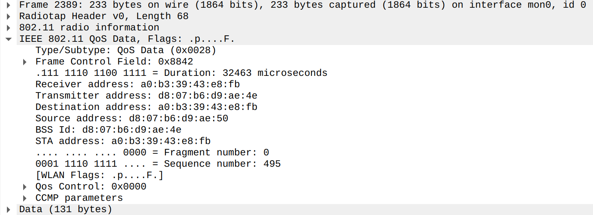

### wifi modes 

* ‘‘ad-hoc’’: everyone sends/receives from whoever
* ‘‘infrastructure’’: designated <i>access points</i>  

* mostly use infrastructure networks

### infrastructure mode  {.smaller}

* networks identified by SSID (Service Set IDentifier) 

   * human readable name

* single SSID can have many access points (example: eduroam)
* clients <i>associated</i> with one access point at a time 

* clients only <i>only</i> send to their current access point
* … even if sending to other nodes on network

### exercise: why through AP? 

* case where going through AP helps performance?
* case where going through AP hurts performance?

### beacons (approx. once per 100ms) 

{}

### probes/probe responses  {.smaller}

* beacons --- listen for a few seconds, find out about nearby networks
* probably need to scan multiple channels 

* can also send explicit probes to learn about networks
* receive responses, with essentially same kind of information

### association  {.smaller}

* client $\rightarrow$ AP: association response (SSID=…)
* AP $\rightarrow$ client: association response (SSID=…)
* + things related to WiFi Security (encryption, passwords, etc.) 

* client $\rightarrow$ AP: deassociation (sometimes)

### moving between APs 

* multiple APs can broadcast have same SSID
* generally: nodes should listen for beacons, measure signal-to-noise ratio 

* eventually decide to change association

### wifi data frames 

{}

### wifi data  {.smaller}

 

* receiver/transmitter address --- this hop
* source/destination address --- final soruce/destination 

* can differ if…  

   * destination is a broadcast/multicast address
   * wireless equivalent of ‘switching’

