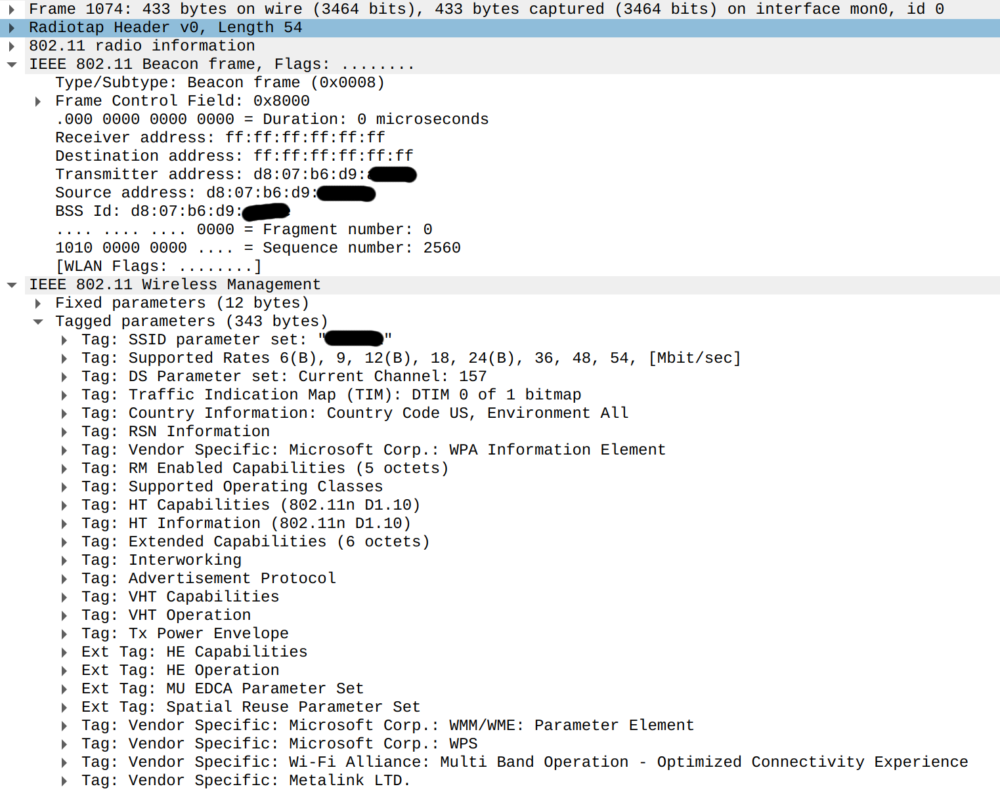
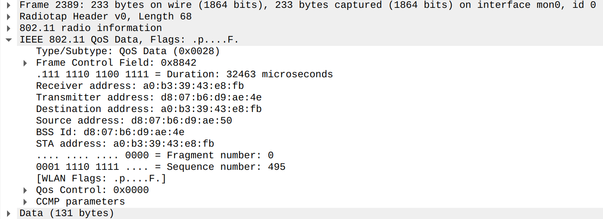

### wifi modes 

* ‘‘ad-hoc’’: everyone sends/receives from whoever
* ‘‘infrastructure’’: designated <i>access points</i>  

* mostly use infrastructure networks

### infrastructure mode 

* networks identified by SSID (Service Set IDentifier) 
   * human readable name
* single SSID can have many access points (example: eduroam)
* clients <i>associated</i> with one access point at a time 

* clients only <i>only</i> send to their current access point
* … even if sending to other nodes on local network

### exercise: why through AP? 

* case where going through AP helps performance?
* case where going through AP hurts performance?

### beacons (approx. once per 100ms) 

{fig-alt="wireshark output showing 802.11 beacon frame. It has a destination address of ff:ff:ff:ff:ff, an SSID, and lots of information about the network (supported rates, encryption, channel information, ...)"}

### probes/probe responses

* beacons
  *  listen for a few seconds, find out about nearby networks
* probably need to scan multiple channels 

* can also send explicit probes to learn about networks
* receive responses, with essentially same kind of information

### association 

* client → AP: association response (SSID=…)
* AP → client: association response (SSID=…)
* + things related to WiFi Security (encryption, passwords, etc.) 

* client → AP: deassociation (sometimes)

### moving between APs 

* multiple APs can broadcast have same SSID
* generally: nodes should listen for beacons, measure signal-to-noise ratio 

* eventually decide to change association

### wifi data frames 

{fig-alt="wireshark output showing 802.11 data frame. It includes a duration, receiver address, transmitter address, desitnation address, source address, BSS ID (=transmitter address), STA address (=receiver address)."}

### wifi data frame addresses

{fig-alt="A→AP1→AP2→B"}
 
* many addresses because multiple hops supported
* receiver/transmitter address --- for just this hop
* source/destination address --- final source/destination 

* can differ if…  

   * destination is a broadcast/multicast address
   * wireless equivalent of ‘switching’

