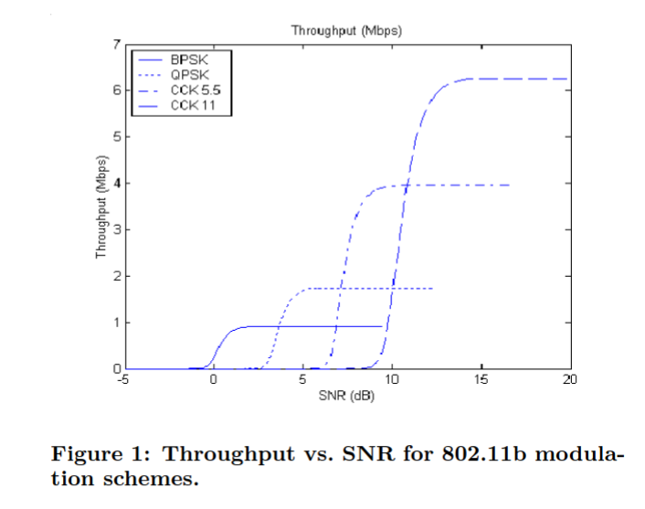

### free space wireless transmission 

* assuming 2.4GHz Wifi, no obstacles, omnidirectional transmission

{width=1000px}

### modifying free space 

* above model assumes no directionality to antennas 

   * signal going twice as far = needs to spread out $2^3$ times as much (3D)

* can do better with directional signal 

   * wifi distance records use this strategy + other changes

### signal to noise ratio  {.smaller}

* often measure power of signal versus power of ‘noise’ 

   * simple model: noise = ‘noise floor’ + interfering transmission

* how strong the ‘symbols’ sent are relative to everything else
* more signal to noise = more bits per unit time 

   * signal to noise limits maximum achievable regardless of how clever encoding is

### free space example  {.smaller}

* 100 mW signal (= 20 dBm)
* at 10 metres for 2.4GHz, about 60 dB of loss $\sim 10^{-4}$ mW of power in antenna 

* suppose ‘noise floor’ is 80 dBm = $10^{-8}$ mW
* signal to noise ratio = $10^{-4}/10^{-8} = 10^{4} = 10000 = 40 \text{dB}$

### SNR and bitrate 

* theory (Shannon-Hartley): max bitrate = $B\log_2\left(1+\frac{S}{N}\right)$
* $B$ = bandwidth of channel
* $S$, $N$ = power per bandwidth of signal, noise (non-log scale)

### SNR and bitrate example  {.smaller}

* max bitrate = $B\log_2\left(1+\frac{S}{N}\right)$
* $B$ = bandwidth = 40MHz maximum for 802.11n in the 2.4Ghz band
* $S$, $N$ = power per bandwidth of signal, noise (non-log scale)
* previous computation $\frac{S}{N} = 10000$ for 10 metre distance
* $\rightarrow 40MHz\log_2\left(1 + \frac{10000}{1}\right) = \log_2(10001)\text{Mbit/s} \approx 531 \text{Mbit/sec}$

### signal to noise ratio and bitrate 

* can recover from more intereference with lower bitrate 

* example: 802.11b supports 1, 2, 5.5, 11 Mbit/sec
* most devices measure signal-to-noise ratio and set bitrate

###  

{}
 [Haratcherev, Langendoen, Lagendijk, Sips, ‘‘Hybrid Rate Control for IEEE 802.11'’ (MobiWac’04), Figure 1]{.mycredit}

### rate control 

* not always best to transmit at fastest rate
* $\rightarrow$ rate control algorithms
* typical method: 

   * have menu of encoding schemes, with different rates, SnR
   * measure succes rate and/or signal to noise rate

### receiving multiple nodes  {.smaller}

 

* A's signal much much stronger at D
* D may still receive A's signal…
* because B relatively too weak to interfere

### collision (non-)detection 

::: {.r-stack .my-full}
{.fragment .fade-in-then-out fragment-index=1}

{.fragment .fade-in-then-out fragment-index=2}

:::

### carrier-sense 

### carrier-not-sensing 

### ‘hidden node’ problem 

 

* B is a ‘hidden node’ for A and vice-versa

### carrier false sensing 

::: {.r-stack .my-full}
{.fragment .fade-in-then-out fragment-index=1}

{.fragment .fade-in-then-out fragment-index=2}

:::

### hidden/exposed node summary 

